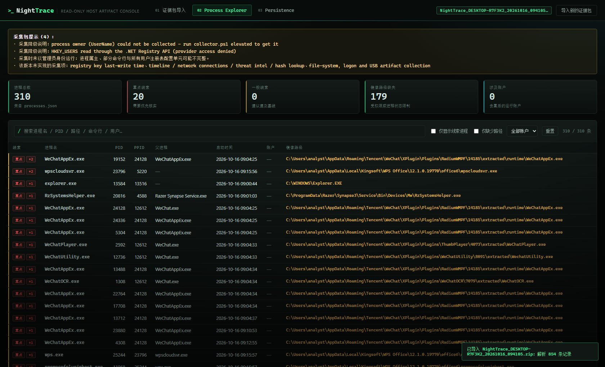
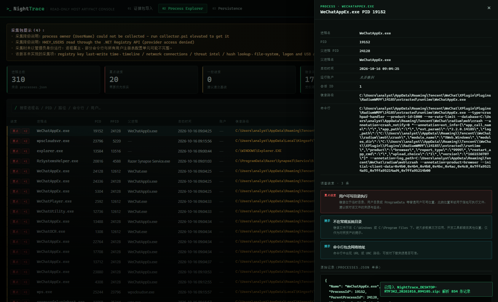
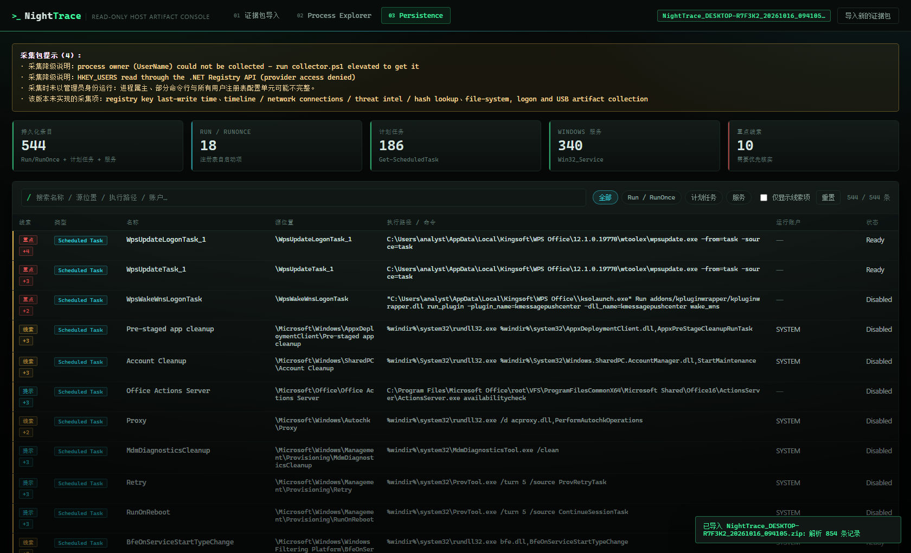
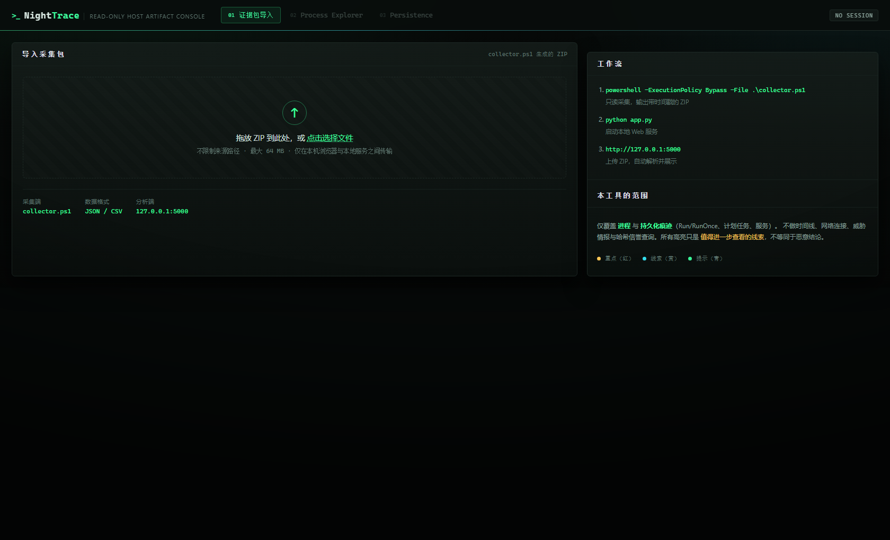

<div align="center">

# NightTrace

**轻量级 Windows 主机痕迹采集与可视化工具 · 只读 · 单机 · 零外联**

`collector.ps1` → ZIP → `app.py` → 浏览器里的两个分析视图

[](#环境要求)
[](#环境要求)
[](#环境要求)
[](#环境要求)
[](#环境要求)
[](#6-安全设计)
[](#6-安全设计)
[](LICENSE)

</div>

---

## 这是什么

一个用于**已获授权的**安全应急响应（IR）与入侵痕迹排查的小工具。

在目标 Windows 主机上跑一个 PowerShell 脚本做**只读采集**，产出一个带时间戳的 ZIP；把 ZIP 拖进本机运行的 Flask 页面，就能直接看到进程和持久化痕迹两条线索的全貌。

**它不是** EDR、不是取证套件、不是自动化恶意判定引擎。它是一个把「采集 → 导入 → 看懂」这条最短链路做扎实的教学 / 自用项目：代码量小、依赖只有一个 Flask、没有任何云端回传。

---

## 界面预览

> 以下截图来自**真实的 `collector.ps1` 采集结果**（本机实测：310 个进程 / 544 条持久化条目），
> 仅对主机名、用户名与用户目录路径做了脱敏替换。不含任何虚构数据。

### Process Explorer



### 进程详情与线索解释



### Persistence



### 证据包导入



---

## 目录

- [这是什么](#这是什么)
- [界面预览](#界面预览)
- [快速开始](#1-快速开始)
- [功能](#2-功能)
- [关于「线索」标记](#3-关于线索标记)
- [采集包结构](#4-采集包结构)
- [架构与数据流](#5-架构与数据流)
- [安全设计](#6-安全设计)
- [已知限制（明确未实现）](#7-已知限制明确未实现)
- [项目结构](#8-项目结构)
- [常见问题](#9-常见问题)
- [免责声明](#10-免责声明)

---

## 1. 快速开始

四条命令跑通全流程：

```powershell
# ① 在目标主机上采集（建议管理员）
powershell -ExecutionPolicy Bypass -File .\collector.ps1

# ② 在本机准备分析端
python -m venv .venv; .venv\Scripts\activate; pip install -r requirements.txt

# ③ 启动 Web 服务
python app.py

# ④ 打开 http://127.0.0.1:5000 ，把 ① 产出的 ZIP 拖进去
```

脚本最后一行会打印可直接复制的路径：

```
ZIP_FILE=C:\Users\you\AppData\Local\Temp\NightTrace\NightTrace-DESKTOP_20261016_093000.zip
```

### 环境要求

| 组件 | 版本 | 说明 |
| --- | --- | --- |
| Windows | 10 / 11 / Server 2016+ | 采集端 |
| PowerShell | 5.1 或 7.x | 采集端，使用系统内置 cmdlet 与 .NET `ZipFile` |
| Python | 3.9+ | 分析端（实测 3.11.9） |
| Flask | 2.2+ | **唯一**第三方依赖（实测 2.2.3） |

无需数据库、Docker、Node.js 或任何外部服务。前端零 CDN 依赖，完全离线可用。

### 采集脚本参数

| 参数 | 说明 |
| --- | --- |
| `-OutputDir <目录>` | 工作目录与 ZIP 的输出基目录，默认 `%TEMP%\NightTrace` |
| `-ZipPath <文件>` | 指定 ZIP 完整路径 |
| `-KeepWorkDir` | 保留中间工作目录（JSON/CSV 明文），便于排查 |
| `-NoZip` | 只采集不打包，打印工作目录路径 |

```powershell
# 例：结果落到 D:\IRTriage，并保留明文目录
powershell -ExecutionPolicy Bypass -File .\collector.ps1 -OutputDir D:\IRTriage -KeepWorkDir
```

**建议以管理员身份运行**：非管理员时脚本仍然可用，但会拿不到进程属主（`UserName`）和部分命令行。这种情况下它**不会用占位数据填充**，而是留空并在页面顶部提示你重新以管理员身份采集。

### 换个端口

```powershell
$env:NIGHTTRACE_PORT=5050; python app.py
```

---

## 2. 功能

两个视图，对应采集端的两个模块。

### 2.1 Process Explorer（进程分析）

展示当前进程的名称、PID、父 PID、父进程名、启动时间、运行账户、镜像路径与命令行。

* 关键词搜索（进程名 / PID / 路径 / 命令行 / 账户）
* 点击表头排序（升 / 降序，空值固定排最后）
* 筛选：仅显示线索进程 / 仅显示缺少镜像路径 / 按账户过滤
* 点击任意行打开右侧详情面板：完整字段 + 线索解释 + 该条原始 JSON + 「查看原始采集文件」

### 2.2 Persistence（持久化痕迹）

按类型分类展示三类常见自启动项：

| 类型 | 来源 |
| --- | --- |
| Run / RunOnce | `HKLM` / `HKCU` / `HKU\<SID>` 下的 `...\CurrentVersion\Run`、`RunOnce`（含 `Wow6432Node` 32 位视图） |
| 计划任务 | `Get-ScheduledTask`，展示任务完整路径、触发器、上次运行时间与返回码、运行级别 |
| Windows 服务 | `Win32_Service`，展示启动类型、运行账户、状态、关联 PID |

支持类型过滤、关键词搜索、按线索过滤、表头排序；详情面板可展开查看该条目的原始采集 JSON。

---

## 3. 关于「线索」标记

> **页面上的高亮只是启发式提示，不是恶意判定。**

规则全部可解释，命中原因会逐条写在详情面板里，并按强度分三档：

| 标记 | 含义 | 触发示例 |
| --- | --- | --- |
| 🔴 **重点** | 需要优先核实的形态 | 镜像 / 目标位于用户可写目录（`Temp`、`AppData`、`ProgramData`）；系统同名进程路径不在 `System32`；持久化命令含编码参数或远程地址 |
| 🟡 **线索** | 值得展开看一眼 | 服务路径未加引号（Unquoted Service Path）；通过 `powershell` / `mshta` / `rundll32` 等工具拉起；Run 键值为空 |
| 🔵 **提示** | 信息缺失或基线对照项 | 镜像路径缺失（权限导致）；不在常规系统目录；父进程已不存在；开机自启 / 登录触发 |

这些形态在**正常软件里同样常见**——例如第三方应用普遍安装在 `AppData`、大量正规服务确实没给路径加引号。请结合资产基线、数字签名与业务上下文判断，不要仅凭标记下结论。

在实测的 854 条记录上，标记分布是 **重点 30 / 线索 28 / 提示 680**——刻意的克制，避免「全部标红等于没标」。
被标为「提示」的绝大多数是 `ExecutablePath` 读取受限（未提权）与第三方软件安装在 `AppData`，属于基线对照信息而非可疑信号。

---

## 4. 采集包结构

```
NightTrace_<主机名>_<yyyyMMdd_HHmmss>.zip
├── collection_meta.json                  # 采集时间、模块状态、耗时、错误、未实现项清单
├── system_info.json                      # 主机与操作系统信息
├── processes.json / .csv                 # 进程
├── persistence_run.json / .csv           # Run / RunOnce 注册表项
├── persistence_scheduled_tasks.json / .csv
└── persistence_services.json / .csv
```

`collection_meta.json` 里的 `modules[]` 记录每个模块的 `status`（`ok` / `failed`）、`recordCount`、`durationMs` 与 `error`；顶层还有 `notes[]`（采集降级说明）与 `notImplemented[]`（本版本明确未实现的采集项）。

**单个模块失败不会中断采集**，其余数据仍然完整可用，失败原因会原样展示在 Web 页面上。

### 采集端如何处理「取不到」的值

采集脚本不用占位数据填充缺失字段，取不到就写 `null`，页面显示为「未采集到」：

| 字段 | 情况 | 处理方式 |
| --- | --- | --- |
| 进程 `UserName` | 非管理员时系统拒绝 | 依次尝试 CIM `-IncludeUserName` → `Get-Process -IncludeUserName`，都失败则留空并写入 `notes[]` |
| 计划任务 `RunAs` | `Principal.UserId` 返回无法解析的占位值（如 `"1"`，真实主体是组） | 置为 `null`，原始值保留在 `RunAsRaw` / `GroupId`，页面给出说明 |
| 计划任务 `Execute` | 动作是 COM 处理程序（本身无 `Execute`） | 记录为 `COM handler (ClassId: {...})`，不再出现空值 |
| 服务「源位置」 | `Win32_Service` 不返回注册表路径 | 由服务名推导 `HKLM\SYSTEM\CurrentControlSet\Services\<名称>`，详情面板标注为推导值 |
| 注册表 `LastWriteTime` | 需要 `RegQueryInfoKey` P/Invoke | 未实现，固定为 `null` |

---

## 5. 架构与数据流

```
┌──────────────────────── 目标主机（被排查的机器） ────────────────────────┐
│                                                                        │
│   collector.ps1                                       只读查询接口      │
│   ├── SystemInfo        ── Get-CimInstance Win32_ComputerSystem        │
│   ├── Processes         ── Win32_Process (+ owner fallback)            │
│   ├── Run/RunOnce       ── HKLM / HKCU / HKU\<SID> 注册表读取          │
│   ├── ScheduledTasks    ── Get-ScheduledTask                           │
│   └── Services          ── Win32_Service                               │
│            │                                                           │
│            ├── 每个模块独立 try/catch —— 单个失败不影响其余模块           │
│            ├── 写出 JSON + CSV + collection_meta.json                   │
│            └── 打包 ──▶ NightTrace_<host>_<时间戳>.zip                   │
└────────────────────────────────┬───────────────────────────────────────┘
                        （手工拷贝 / U 盘 / 内网传输）
                                 ▼
┌──────────────────────── 分析主机（分析人员自己的机器） ───────────────────┐
│   app.py  (Flask, 127.0.0.1:5000)                                      │
│   ├── 上传校验：ZIP 合法性 → 路径穿越 / 绝对路径 / 符号链接 / 体积 / 条目数  │
│   ├── 解压到临时私有会话目录 → 解析 JSON/CSV → 归一化 → 内存会话          │
│   └── 浏览器：Process Explorer ／ Persistence 两个视图                   │
│        （数据不出本机，无数据库、无外部服务）                              │
└────────────────────────────────────────────────────────────────────────┘
```

前端是原生 HTML/CSS/JS，无框架、无构建步骤、无 CDN。分析端只在内存里保存会话，6 小时后自动清理。

---

## 6. 安全设计

* **只读**：采集脚本不写注册表、不改服务、不装任何东西，只调用查询类接口。
* **不越界**：不做隐蔽驻留、远程执行、权限提升、安全软件规避——这些功能不存在，也不打算加。
* **ZIP 校验**：上传后先验证是否为合法 ZIP，再逐条成员校验——拒绝绝对路径、`..` 路径穿越、盘符路径、符号链接与空字节，只解压白名单文件名；同时限制压缩包 **64 MB**、解压总量 **512 MB**、条目数 **500**、单条目 **128 MB**。
* **就地解析**：ZIP 解压到系统临时目录下的私有会话目录，解析完直接展示，无需手工解压。
* **本地监听**：默认只绑定 `127.0.0.1`，不提供任何对外接口，不主动上传数据。
* **会话过期**：会话与临时目录 6 小时后自动清理。

已实测拒绝：`../../processes.json`、`/abs/path/x.json`、`C:\...`、符号链接条目、超过 500 条目的包、损坏 ZIP、零字节文件、空包。越界条目一律不落盘。

> ⚠️ 只上传你自己或你被授权处理的主机产生的采集包。采集包内含进程命令行、注册表值等敏感信息，请注意保管与传输方式。

---

## 7. 已知限制（明确未实现）

v1 的目标是「采集 → 导入 → 两个页面」的最小闭环。以下能力**尚未实现**，代码中也不存在对应逻辑（同时记录在 `collection_meta.json` 的 `notImplemented[]` 与页面提示中）：

* 注册表键的最后写入时间（需 `RegQueryInfoKey` P/Invoke，详情面板显示为「未采集到」并给出说明）
* 数字签名校验、文件哈希与威胁情报 / 信誉查询
* 时间线视图、网络连接、登录与 USB 等其余痕迹
* 进程树可视化、导出报告、多包对比
* 数据库、多用户、历史任务留存（会话仅存内存）
* 前端图表库（当前零 CDN 依赖，完全离线可用）

非管理员采集时，`UserName` 与部分 `CommandLine` 可能为空——页面把它标成「未采集到」，而不是用占位数据填充。

---

## 8. 项目结构

```
NightTrace/
├── collector.ps1              # 只读采集脚本（进程 + 持久化），输出 ZIP
├── app.py                     # Flask 本地服务：上传校验 / 解析 / 展示
├── requirements.txt           # 只有一行：Flask
├── templates/
│   └── index.html             # 单页界面，两个功能视图 + 详情抽屉
├── static/
│   ├── style.css              # 暗色 Cybersecurity 主题（等宽字体 / 扫描线）
│   └── app.js                 # 表格、搜索、排序、筛选、启发式线索
├── docs/
│   └── screenshots/           # README 截图（已脱敏）
├── .gitignore                 # 排除 .venv / __pycache__ / *.zip 证据包
├── LICENSE                    # MIT
└── README.md
```

> `.gitignore` 里显式排除了 `*.zip`：采集包含有进程命令行与注册表值，**不要**把它提交到公开仓库。

---

## 9. 常见问题

| 现象 | 原因与处理 |
| --- | --- |
| 上传报「No NightTrace artifacts were found」 | ZIP 里没有 `processes.json` 等白名单文件，确认传的是 `collector.ps1` 生成的包 |
| 页面提示「进程属主为空」 | 采集时不是管理员，重新以管理员身份运行 `collector.ps1` |
| 某个模块状态为 `failed` | 采集端该模块报错，`collection_meta.json` 的 `modules[].error` 里有原始信息 |
| 采集脚本控制台输出是英文 | 刻意为之，避免不同代码页下的乱码；**数据本身**使用 UTF-8 无 BOM 保存 |
| 计划任务「运行账户」显示为空 | `Principal.UserId` 返回了无法解析的占位值，原始值保留在 `RunAsRaw` / `GroupId` |
| 端口 5000 被占用 | `$env:NIGHTTRACE_PORT=5050; python app.py` |
| 改了代码但页面没变 | 确认只有一个 Flask 进程在监听 5000（`netstat -ano \| findstr :5000`），Windows 的 `SO_REUSEADDR` 会让多个实例同时响应 |

---

## 10. 免责声明

本项目仅用于**获得明确授权的**主机取证与应急响应场景，用于排查自己管理的设备。

请遵守所在地法律法规；**不得**用于未授权的访问、监控或数据获取。使用本工具产生的一切后果由使用者承担。

## License

[MIT](LICENSE)
